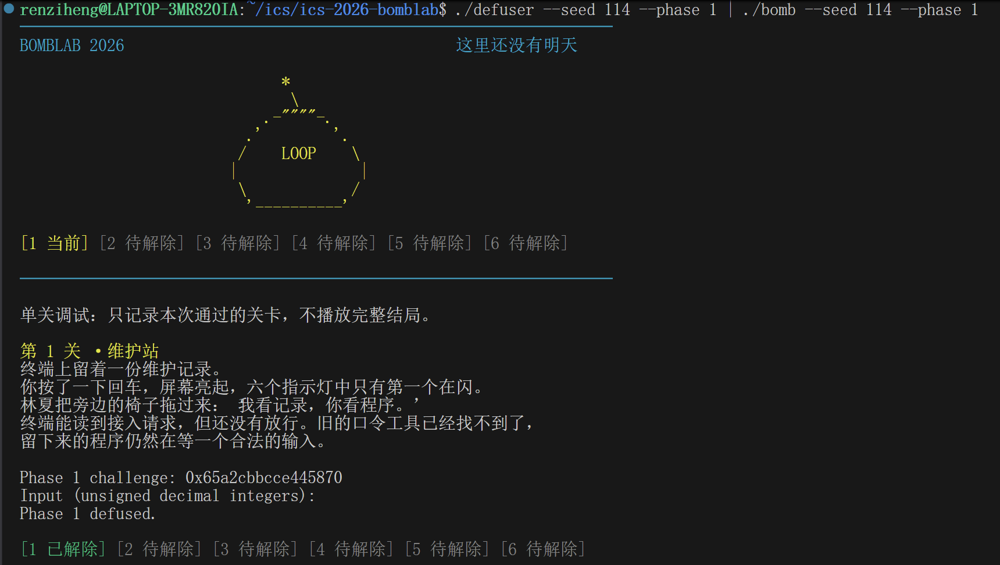
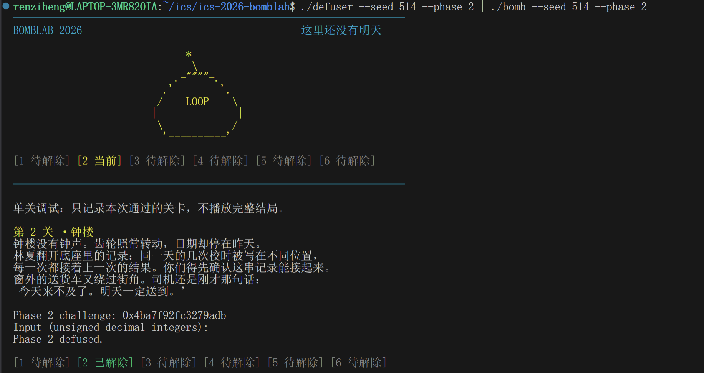
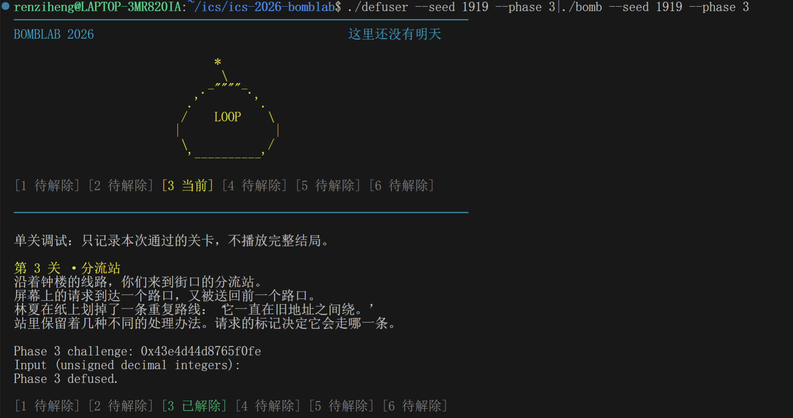
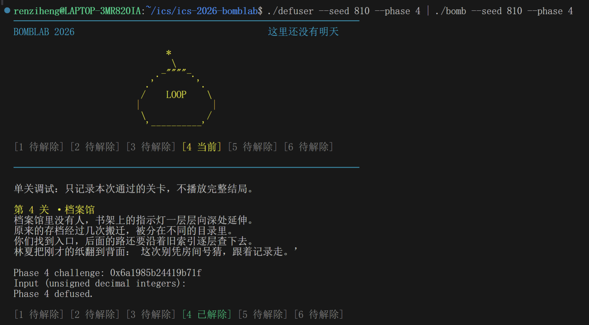
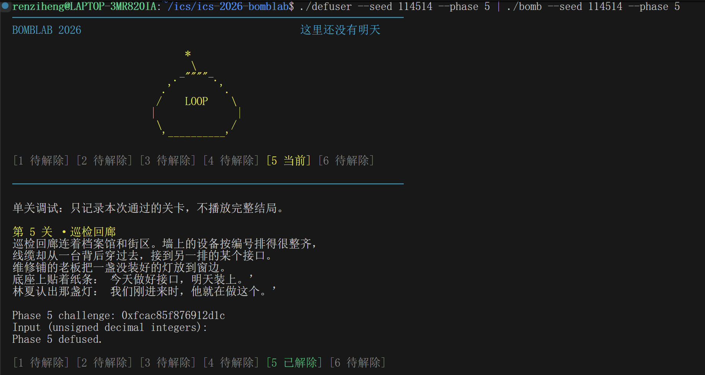
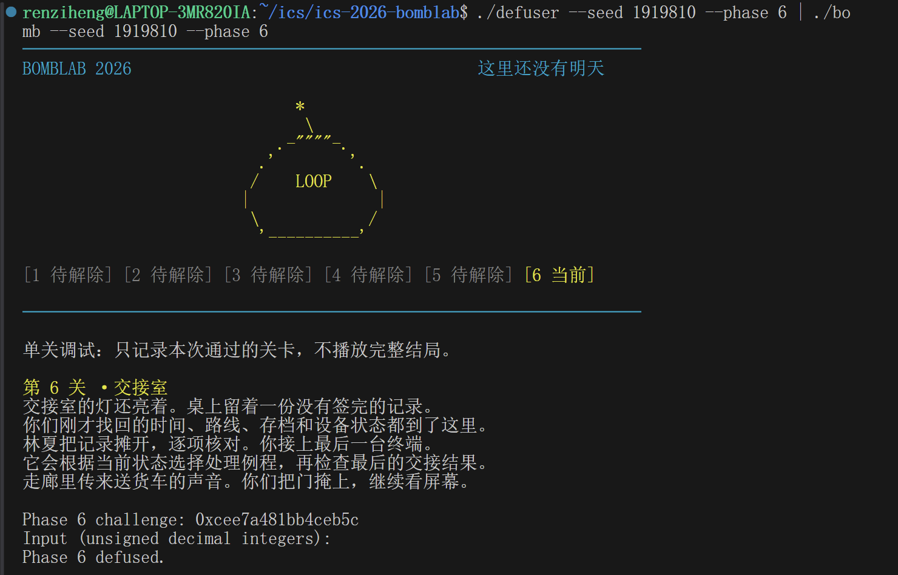
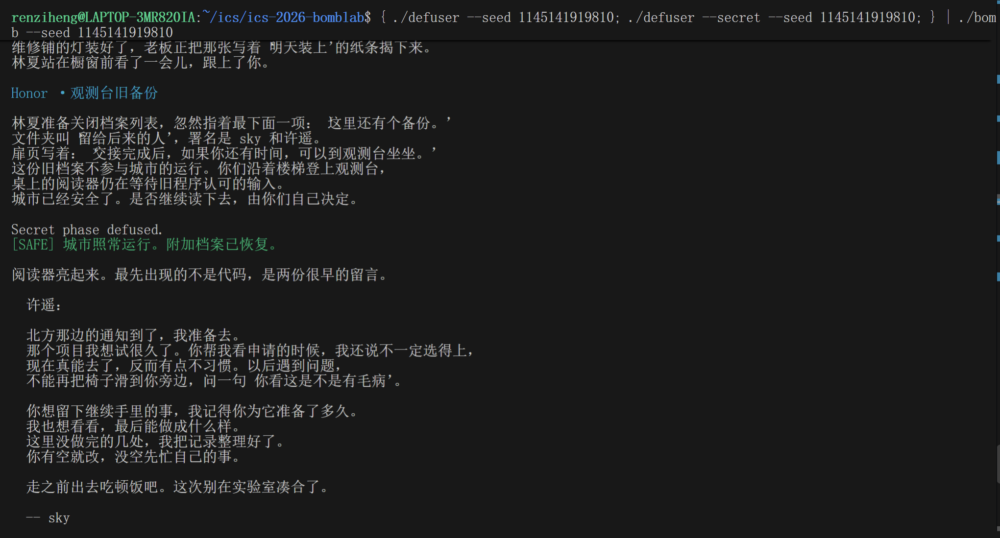

# DataLab 实验报告

25803060007 任子衡

以下逐题介绍思路。

## Phase 1
运行指令`objdump -d --no-show-raw-insn --disassemble=phase_01 ./bomb > phase_01.S`，得到汇编代码。

首先看到`40203a:	call   402c10 <valid_u32_fields>`一行，其第二个参数即count被放在%esi中，`40202d:	mov    $0x1,%esi`，表明count为1；运行`x/s 0x403182`发现 结果是`"%u"`，即题目要求输入1个`uint32_t`。后面的题目同理。

根据
```asm
40202a:	mov    %rsi,%r12
402068:	mov    %r12,%rdi
```
两行，得知`challenge`被放进`%rdi`中，参与`40206b:	call   401fe0 <p1_compute>`的运行。后面的题目同理。

运行`disas p1_compute`，发现`challenge`作为`p1_compute`函数唯一的参数，转化为三个中间变量x, y, z，分别由
```asm
0x0000000000401fed <+13>:    shr    $0x20,%rax

0x0000000000401ff1 <+17>:    mov    %edi,%r8d

0x0000000000401ff4 <+20>:    shr    $0x10,%rdx
```
产生。可以分别解码为
```c
uint32_t x  = (uint32_t)(challenge >> 32)
uint32_t y  = (uint32_t)challenge
uint64_t z = challenge >> 16
```
接着进行了计算
```c
uint32_t a = p1_step2(x, y)
uint32_t b = p1_step0(y, z)
uint32_t c = p1_step1(b, a)
```
并将c放进%eax，作为输出。

运行`disas p1_step2`、`disas p1_step0`、`disas p1_step1`发现三个函数都是进行简单的代数运算：
```asm
0x0000000000401fd4 <+4>:     lea    (%rdi,%rsi,8),%eax
0x0000000000401fd7 <+7>:     xor    $0xc995,%eax
```
表明step2进行的是将参数1与8 * 参数2相加，结果与`0xc995`取异或；
```asm
0x0000000000401fb4 <+4>:     xor    $0x7aa0,%esi
0x0000000000401fba <+10>:    lea    (%rsi,%rdi,2),%eax
```
表明step0进行的是将第二个参数与`0x7aa0`取异或，并与参数1的两倍相加；
```asm
0x0000000000401fc4 <+4>:     sub    %esi,%edi
0x0000000000401fc6 <+6>:     lea    0x85f4(%rdi,%rdi,4),%eax
```
表明step1进行的是第一个参数减去第二个参数的差*5，加上`0x85f4`。

最后将`p1_compute(challenge)`的值放进`values`中，即可完成实验。

下图表明使用`seed`=114成功通过本题：


## Phase 2
运行指令`objdump -d --no-show-raw-insn --disassemble=phase_02 ./bomb > phase_02.S`，得到汇编代码。

与Phase 1同理，这次要输入的是6个uint32_t。

先看第一个数：
```asm
4020ea: mov %r13,%rax
4020ed: mov -0x40(%rbp),%esi
4020f0: shr $0x25,%rax
4020f4: and $0xf,%eax
4020f7: add $0xc,%eax
4020fa: cmp %eax,%esi
4020fc: jne 4020a5
```
可以提取出第一个数`values[0] = (uint32_t)(((challenge >> 37) & 0xf) + 12)`。

紧接着看剩余5个数的计算方式，不难发现一个循环：
```asm
  402108:	mov    %r13,%rax
  40210b:	shr    %cl,%rax
  40210e:	and    $0x3f,%eax
  402111:	add    %edx,%eax
  402113:	xor    %esi,%eax
  402115:	mov    -0x40(%rbp,%rdx,4),%esi
  402119:	lea    (%rax,%rax,2),%eax
  40211c:	cmp    %eax,%esi
  40211e:	jne    4020a5 <phase_02+0x25>
  402120:	add    $0x1,%rdx
  402124:	add    $0x5,%ecx
  402127:	cmp    $0x6,%rdx
  40212b:	jne    402108 <phase_02+0x88>
```
每次当`%rdx`的数值不为6时，就重新回到`0x402108`处，在每个循环中这个数值都增加1，故将其命名为`i`，循环的条件就是`i < 6`。同样地，`%ecx`的数值每个循环中都增加5，故将其命名为`j`。每次循环中，都将上一次循环产生的数值`prev`（初始值为`values[0]`，存于`%eax`）进行如下计算后产生values[i]，并将这个数值作为下一次循环的`prev`：
```c       
uint32_t t = (uint32_t)(((challenge >> j) & 0x3f) + i);
t ^= prev;
j += 5;
values[i] = t * 3;
prev = values[i];
```
最后来看`i`和`j`两个参数的初始值，它们在这里定义：
```asm
4020fe: mov    $0x12,%ecx
402103: mov    $0x1,%edx
```
这说明，`i`的初始值为1，`j`的初始值为18。将整个循环拼接起来，就能一个接一个地得到`values[]`中的数值。下图表明使用`seed`=514成功通过本题：

## Phase 3
运行指令`objdump -d --no-show-raw-insn --disassemble=phase_03 ./bomb > phase_03.S`，得到汇编代码。

与Phase 1同理，这次要输入的是2个uint32_t。

首先观察以下代码，会发现要比较的第一个数即`values[0]`的数值为`challenge & 7`：
```asm
  40229c:	mov    %r12d,%edi
  40229f:	xor    %eax,%eax
  4022a1:	and    $0x7,%edi
  4022a4:	cmp    %edi,-0x18(%rbp)
```
其次观察以下代码，会发现要比较的第二个数即`values[1]`的计算如下：
```asm
  4022a9:	mov    %r12,%rax
  4022ac:	mov    %r12,%rsi
  4022af:	shr    $0x3,%rax
  4022b3:	shr    $0x20,%rsi
  4022b7:	xor    %eax,%esi
  4022b9:	call   4021f0 <p3_dispatch>
  4022be:	cmp    %eax,-0x14(%rbp)
```
发现函数`p3_dispatch`的第一个参数`%edi`即为前面计算出的`values[0]`；第二个参数`%esi`可通过 `((challenge>>32) ^ ((challenge>>3) & 0xffffffffu)) & 0xffffffffu`计算得到。故`values[1] = p3_dispatch(values[0] , ((challenge>>32) ^ ((challenge>>3) & 0xffffffffu)) & 0xffffffffu)`。

接着运行`disas p3_dispatch`，观察这个函数的具体形式：
```asm
   0x00000000004021f4 <+4>:     mov    %edi,%eax
   0x00000000004021f6 <+6>:     mov    %esi,%edi
   0x00000000004021f8 <+8>:     cmp    $0x7,%eax
   0x00000000004021fb <+11>:    ja     0x402245 <p3_dispatch+85>
   0x00000000004021fd <+13>:    notrack jmp *0x4057e0(,%rax,8)
   0x0000000000402205 <+21>:    nopl   (%rax)
   0x0000000000402208 <+24>:    jmp    0x4021c0 <p3_case_6>
   0x000000000040220a <+26>:    nopw   0x0(%rax,%rax,1)
   0x0000000000402210 <+32>:    jmp    0x4021d0 <p3_case_7>
   0x0000000000402212 <+34>:    nopw   0x0(%rax,%rax,1)
   0x0000000000402218 <+40>:    jmp    0x402140 <p3_case_0>
   0x000000000040221d <+45>:    nopl   (%rax)
   0x0000000000402220 <+48>:    jmp    0x4021b0 <p3_case_5>
   0x0000000000402222 <+50>:    nopw   0x0(%rax,%rax,1)
   0x0000000000402228 <+56>:    jmp    0x402150 <p3_case_1>
   0x000000000040222d <+61>:    nopl   (%rax)
   0x0000000000402230 <+64>:    jmp    0x402190 <p3_case_4>
   0x0000000000402235 <+69>:    nopl   (%rax)
   0x0000000000402238 <+72>:    jmp    0x402180 <p3_case_3>
   0x000000000040223d <+77>:    nopl   (%rax)
   0x0000000000402240 <+80>:    jmp    0x402170 <p3_case_2>
   0x0000000000402245 <+85>:    xor    %eax,%eax
   0x0000000000402247 <+87>:    ret
```
可以看到，这是通过跳转表实现`switch`操作，首先将第一个参数`i`与7比较，若大于7则直接输出0；否则，跳转到`0x4057e0 + i*8`处存储的地址，执行对应条目。

于是通过运行`x/8gx 0x4057e0`，读取`*0x4057e0`这个表格的内容，如下：
`
0x4057e0: 0x402218  0x402220  0x402228  0x402230
0x4057f0: 0x402238  0x402240  0x402208  0x402210
`

8个地址分别为`i`为0到7时跳转的地址，例如计算出`i = 0`时，跳转到`0x402218`，执行`0x0000000000402218 <+40>:    jmp    0x402140 <p3_case_0>`。完整映射关系列举如下：
| i | 表项 | 桩指令 | case |
|---|------|--------|------|
| 0 | 0x402218 | jmp 0x402140 | case_0 |
| 1 | 0x402220 | jmp 0x4021b0 | case_5 |
| 2 | 0x402228 | jmp 0x402150 | case_1 |
| 3 | 0x402230 | jmp 0x402190 | case_4 |
| 4 | 0x402238 | jmp 0x402180 | case_3 |
| 5 | 0x402240 | jmp 0x402170 | case_2 |
| 6 | 0x402208 | jmp 0x4021c0 | case_6 |
| 7 | 0x402210 | jmp 0x4021d0 | case_7 |

最后，我们运行`disas p3_case_n`($0 \le n\le 7$)，从而获得每个`case`的具体内容。比如`p3_case_0`代码如下：
```asm
   0x0000000000402140 <+0>:     endbr64
   0x0000000000402144 <+4>:     lea    0x329b(%rdi,%rdi,4),%eax
   0x000000000040214b <+11>:    ret
```
可以看出这等价于表达式`5x + 0x329b`。同理可列出完整的对应关系：
| case | 表达式 |
|------|--------|
| 0 | 5x + 0x329b |
| 1 | (x ^ 0x4c5b) + (x>>2) |
| 2 | (2x) ^ 0xce02 |
| 3 | 3x + 0x96fb |
| 4 | (x ^ 0x69f) + (x>>2) |
| 5 | 5x + 0x70cb |
| 6 | 3x + 0x1d07 |
| 7 | (4x) ^ 0xf8de |

合并起来，将`i`与正确的（而非序号相等的）表达式对应起来，通过`switch`即可得到完整的`p3_dispatch`函数。将这个函数代入`values[]`的计算中，即可得到正确结果。

下图表明使用`seed`=1919成功通过本题：


## Phase 4
运行指令`objdump -d --no-show-raw-insn --disassemble=phase_04 ./bomb > phase_04.S`，得到汇编代码。

与Phase 1同理，这次要输入的是1个uint32_t。这个数字这样产生：
```asm
4023a5:	call   4022d0 <p4_walk>
4023aa:	cmp    %eax,-0x14(%rbp)
```
这说明`values[0] = p4_walk(<args>)`。下面分析这个函数的参数值：
```asm
402388: mov    %r12,%rcx
40238b: mov    %r12,%rax
40238e: mov    %r12d,%edi
402391: xor    %esi,%esi
402393: shr    $0x20,%rax
402397: shr    $0x7,%rcx
40239b: and    $0x7f,%edi
40239e: mov    $0x7f,%edx
4023a3: xor    %eax,%ecx
```
可以看出，第一个参数`%edi`为`challenge & 0x7f`，第二个参数`%esi`为`0`，第三个参数`edx`为`0x7f`，第四个参数`%rcx`为`(challenge>>7) ^ (challenge>>32)`。也就是说，`values[0] = p4_walk(challenge & 0x7f,0,0x7f,(challenge>>7) ^ (challenge>>32))`。将四个参数分别命名为`x`,`lo`,`hi`,`key`，原因接下来解释。

然后运行`disas p4_walk`，获得函数`p4_walk`的汇编代码：
```asm
0x00000000004022d6 <+6>:     mov    %edx,%edi
0x00000000004022d8 <+8>:     sub    %esi,%edi
0x00000000004022da <+10>:    shr    $1,%edi
0x00000000004022dc <+12>:    add    %esi,%edi
0x00000000004022de <+14>:    cmp    %eax,%edi
0x00000000004022e0 <+16>:    je     0x402330 <p4_walk+96>
```
说明在`mid = (lo + hi)/2`与`x`相等时，跳转执行`0x402330`。
```asm
0x0000000000402330 <+96>:    lea    0xc7(%rdi),%eax
0x0000000000402336 <+102>:   xor    %ecx,%eax
0x0000000000402338 <+104>:   ret
```
`0x402330`的含义是：输出`(mid + 199) ^ key`。

若`mid`与`x`不相等，则执行：
```asm
0x00000000004022e2 <+18>:    push   %rbp
0x00000000004022e3 <+19>:    mov    %rsp,%rbp
0x00000000004022e6 <+22>:    push   %rbx
0x00000000004022e7 <+23>:    lea    (%rdi,%rcx,1),%ebx
0x00000000004022ea <+26>:    sub    $0x8,%rsp
0x00000000004022ee <+30>:    cmp    %edi,%eax
0x00000000004022f0 <+32>:    jb     0x402310 <p4_walk+64>
```
先将`mid + key`存入`ebx`（寄存器名和变量名相同），再比较`x`与`mid`，若`x < mid`则跳转执行`0x402310`，否则顺序执行`0x4022f2`。

接下来观察`0x4022f2`：
```asm
0x00000000004022f2 <+34>:    lea    0x1(%rdi),%esi
0x00000000004022f5 <+37>:    mov    %eax,%edi
0x00000000004022f7 <+39>:    call   0x4022d0 <p4_walk>
0x00000000004022fc <+44>:    lea    (%rax,%rax,4),%eax
0x00000000004022ff <+47>:    xor    %ebx,%eax
0x0000000000402301 <+49>:    mov    -0x8(%rbp),%rbx
0x0000000000402305 <+53>:    leave
0x0000000000402306 <+54>:    xor    $0x7,%eax
0x0000000000402309 <+57>:    ret
```
将`lo`更新为`mid + 1`，调用`p4_walk(x, mid + 1, hi, key)`，将这次的输出值r进行如下运算后输出：`(5*r) ^ (mid+key) ^ 0x7`。

再观察`0x402310`：
```asm 
0x0000000000402310 <+64>:    lea    -0x1(%rdi),%edx
0x0000000000402313 <+67>:    mov    %eax,%edi
0x0000000000402315 <+69>:    call   0x4022d0 <p4_walk>
0x000000000040231a <+74>:    lea    (%rax,%rax,4),%eax
0x000000000040231d <+77>:    xor    %ebx,%eax
0x000000000040231f <+79>:    mov    -0x8(%rbp),%rbx
0x0000000000402323 <+83>:    leave
0x0000000000402324 <+84>:    xor    $0xf,%eax
0x0000000000402327 <+87>:    ret
```
将`hi`更新为`mid - 1`，调用`p4_walk(x, lo, mid - 1, key)`，将这次的输出值r进行如下运算后输出：`(5 * r) ^ ebx ^ 0xf`。

我们不难发现函数的结构类似二分查找，`x`是待查找的数值，`lo`和`hi`分别是下界和上界，故使用这些变量名命名`p4_walk`的参数。

将几种情况合并起来即可得到完整的`p4_walk`函数。将这个函数代入`values[]`的计算中，即可得到正确结果。

下图表明使用`seed`= 810成功通过本题：


## Phase 5
运行指令`objdump -d --no-show-raw-insn --disassemble=phase_05 ./bomb > phase_05.S`，得到汇编代码。

与Phase 1同理，这次要输入的是2个uint32_t。考虑计算逻辑：
```asm
   0x0000000000402470 <+80>:    mov    %r12,%rdi
   0x0000000000402473 <+83>:    call   0x4023c0 <p5_traverse>
   0x0000000000402478 <+88>:    mov    %eax,%edx
   0x000000000040247a <+90>:    xor    %eax,%eax
   0x000000000040247c <+92>:    cmp    %edx,-0x1c(%rbp)
   0x000000000040247f <+95>:    jne    0x402445 <phase_05+37>
   0x0000000000402481 <+97>:    mov    -0x14(%rbp),%eax
   0x0000000000402484 <+100>:   cmp    %eax,-0x18(%rbp)
```

发现输入的第一个整数`values[0] = p5_traverse(challenge, &last_f4)`，第二个整数即为`last_f4`。

在gdb中运行指令`disas p5_traverse`，先设函数签名为`p5_traverse(uint64_t x, uint32_t *out)`。

函数内对同一指针`%rdx`（从`p5_heads`取出）有三处不同偏移访问：
```asm
   0x00000000004023e7 <+39>:    mov    0x4(%rdx),%esi
   0x00000000004023ec <+44>:    xor    (%rdx),%eax
   0x0000000000402404 <+68>:    mov    0x8(%rdx),%rdx
```
偏移+0、+4用32位寄存器访问，说明存储两个uint32_t；偏移+8用64位寄存器访问，且读出的值又被当基址继续解引用，说明存储一个指针。从而得出这里存储的是一个结构体，可认为是链表的一个节点：
```c
struct node {
    uint32_t f0;
    uint32_t f4;
    struct node *next;
};
```
考虑以下代码：
```asm
   0x00000000004023c4 <+4>:     mov    %rdi,%rax
   0x00000000004023cd <+13>:    and    $0x7,%eax
   0x00000000004023d4 <+20>:    mov    0x405b20(,%rax,8),%rdx
```
可以发现一个指针数组，位于`0x405b20`，设为`p5_heads`，共8项，用`x`的低3位索引，取出的`%rdx`即可写为`struct node *n = p5_heads[x & 7]`。

下面研究初始值：
```asm
   0x00000000004023c7 <+7>:     mov    %rdi,%rcx
   0x00000000004023ca <+10>:    mov    %rsi,%r8
   0x00000000004023cd <+13>:    and    $0x7,%eax
   0x00000000004023d0 <+16>:    shr    $0x3,%rcx
   0x00000000004023d4 <+20>:    mov    0x405b20(,%rax,8),%rdx
   0x00000000004023dc <+28>:    mov    %rdi,%rax
   0x00000000004023df <+31>:    shr    $0x20,%rdi
   0x00000000004023e3 <+35>:    shr    $0x6,%rax
   0x00000000004023e7 <+39>:    mov    0x4(%rdx),%esi
   0x00000000004023ea <+42>:    xor    %edi,%eax
   0x00000000004023ec <+44>:    xor    (%rdx),%eax
   0x00000000004023ee <+46>:    mov    %ecx,%edi
   0x00000000004023f0 <+48>:    xor    $0xf243,%eax
   0x00000000004023f5 <+53>:    mov    %esi,(%r8)
   0x00000000004023f8 <+56>:    add    %esi,%eax
```
可以得到其设定：
```c
    uint32_t eax = (uint32_t)(x >> 6) ^ (uint32_t)(x >> 32)^ n->f0 ^ 0xf243u;
    eax += n->f4;
    *out = n->f4;
```
之后又有一个循环遍历：
```asm
   0x00000000004023fa <+58>:    and    $0x3,%edi
   0x00000000004023fd <+61>:    je     0x402419 <p5_traverse+89>
   0x00000000004023ff <+63>:    mov    $0x1,%ecx
   0x0000000000402404 <+68>:    mov    0x8(%rdx),%rdx
   0x0000000000402408 <+72>:    add    $0x1,%ecx
   0x000000000040240b <+75>:    mov    0x4(%rdx),%esi
   0x000000000040240e <+78>:    xor    (%rdx),%eax
   0x0000000000402410 <+80>:    add    %esi,%eax
   0x0000000000402412 <+82>:    mov    %esi,(%r8)
   0x0000000000402415 <+85>:    cmp    %ecx,%edi
   0x0000000000402417 <+87>:    jae    0x402404 <p5_traverse+68>
```
可以翻译为
```c
unsigned count = (unsigned)(x >> 3) & 3;
for (unsigned i = 1; i <= count; i++) {
    n = n->next;
    eax ^= n->f0;
    eax += n->f4;
    *out = n->f4;
}
return eax;
```
最后解析数组`p5_heads`。在gdb中执行`x/8gx 0x405b20`，输出如下：
```
0x405b20 <p5_heads>:    0x0000000000405ba0      0x0000000000405b90
0x405b30 <p5_heads+16>: 0x0000000000405c10      0x0000000000405c00
0x405b40 <p5_heads+32>: 0x0000000000405bd0      0x0000000000405bc0
0x405b50 <p5_heads+48>: 0x0000000000405b70      0x0000000000405b60
```
地址最小的结点在`0x405b60`，以此为`p5_nodes[0]`，并从小到大赋予编号，就得到了这个数组为
`*p5_heads[8]={&p5_nodes[4],&p5_nodes[3],&p5_nodes[11],&p5_nodes[10],&p5_nodes[7],&p5_nodes[6],&p5_nodes[1],&p5_nodes[0]}`。

为了得到`p5_nodes`这个数组，在gdb中运行`x/24gx 0x405b60`，例如为了得到`p5_nodes[0]`，读取第一行`0x405b60 <p5_nodes>:    0x00000a5a000098e7      0x0000000000405bb0`，第1个qword在小端存储存放`f0`和`f4`，分别为`0x000098e7`和`0x00000a5a`；第2个qword存储的即为`next`指针，为`0x405bb0`，即为`&p5_nodes[5]`。`p5_nodes`的其他元素依次类推。

将这些代码组合起来，即可得到本题的完整实现。下图表明使用`seed`= 114514成功通过本题：

## Phase 6
运行指令`objdump -d --no-show-raw-insn --disassemble=phase_06 ./bomb > phase_06.S`，得到汇编代码。

与Phase 1同理，这次要输入的是1个uint32_t。输出的数值可以表示为`p6_dispatch(challenge)`。下面分析这个函数的具体实现。

gdb中运行`disas p6_dispatch`，得到这个函数的汇编实现：
```asm
   0x0000000000402514 <+4>:     push   %rbp
   0x0000000000402515 <+5>:     mov    %rsp,%rbp
   0x0000000000402518 <+8>:     push   %rbx
   0x0000000000402519 <+9>:     mov    %rdi,%rbx
   0x000000000040251c <+12>:    shr    $0x6,%rdi
   0x0000000000402520 <+16>:    mov    %rbx,%rax
   0x0000000000402523 <+19>:    shr    $0x20,%rax
   0x0000000000402527 <+23>:    xor    %eax,%edi
   0x0000000000402529 <+25>:    mov    %rbx,%rax
   0x000000000040252c <+28>:    sub    $0x8,%rsp
   0x0000000000402530 <+32>:    and    $0x38,%ebx
   0x0000000000402533 <+35>:    and    $0x7,%eax
   0x0000000000402536 <+38>:    call   *0x405dc0(,%rax,8)
   0x000000000040253d <+45>:    xor    $0x625,%eax
   0x0000000000402542 <+50>:    mov    %eax,%edi
   0x0000000000402544 <+52>:    call   *0x405dc0(%rbx)
   0x000000000040254a <+58>:    mov    -0x8(%rbp),%rbx
   0x000000000040254e <+62>:    leave
   0x000000000040254f <+63>:    add    $0x3f57,%eax
   0x0000000000402554 <+68>:    ret
```
两条`call *0x405dc0(...)`带 *，是间接调用：`0x405dc0` 是函数指针数组`p6_ops` 的基址，按变址取函数指针再跳转。将其他的代码考虑进来，就可以得到这个函数的具体实现：
```c
uint32_t p6_dispatch(uint64_t x)
{
    uint32_t edi = (uint32_t)(x >> 6) ^ (uint32_t)(x >> 32);
    uint32_t eax = p6_ops[x & 7](edi);
    eax ^= 0x625;
    eax = p6_ops[(x & 0x38) >> 3](eax);
    eax += 0x3f57;
    return eax;
}
```
下面分析`p6_ops`的具体内容。gdb中运行`x/8a 0x405dc0`，得到：
```
0x405dc0 <p6_ops>:      0x0000000000402490   0x00000000004024e0
0x405dd0 <p6_ops+16>:   0x00000000004024e0   0x00000000004024c0
0x405de0 <p6_ops+32>:   0x0000000000402500   0x00000000004024a0
0x405df0 <p6_ops+48>:   0x00000000004024c0   0x00000000004024b0
```
说明`p6_ops`总共有8项，用所在地址的后三位为每个函数命名，例如存于`0x402490`的函数命名为`f_490`。这样这个数组可以表示为 `{f_490, f_4e0, f_4e0, f_4c0, f_500, f_4a0, f_4c0, f_4b0}`。

最后可以在gdb中依次查看这些函数的具体内容。例如在gdb中运行`disas 0x402490`，即可看到函数`f_490`的汇编代码：
```asm
   0x0000000000402490 <+0>:     endbr64
   0x0000000000402494 <+4>:     mov    %edi,%eax
   0x0000000000402496 <+6>:     xor    $0xc379,%eax
   0x000000000040249b <+11>:    lea    (%rax,%rdi,4),%eax
   0x000000000040249e <+14>:    ret
```
可以看出这个函数相当于`(a ^ 0xc379u) + 4u*a`，其中`a`为参数。

同理可以列出所有的函数的具体内容：
| 表索引 | 地址 | 函数体 |
|--------|------|--------|
| 0 | 0x402490 | (a ^ 0xc379) + 4a |
| 1 | 0x4024e0 | (4a + 0xc948) ^ 3a |
| 2 | 0x4024e0 | 同索引 1 |
| 3 | 0x4024c0 | ((a >> 7) ^ a) + 0x4a15 |
| 4 | 0x402500 | (a >> 1) \| (a << 31) |
| 5 | 0x4024a0 | ((a<<7)\|(a>>25)) ^ 0x8b4bu |
| 6 | 0x4024c0 | 同索引 3 |
| 7 | 0x4024b0 | (a + 0x5cc9) ^ (a >> 5) |

最后将这些函数、`p6_ops`、`p6_dispatch`等组合起来，就可以输出正确的结果。下图证明在`seed`=1919810下成功通过测试：



## Honor
在gdb中运行`disas secret_gate`，得到`secret_gate`函数的汇编代码。

先分析其输入：
```
   0x00000000004026fc <+60>:    call   0x401190 <strlen@plt>
   0x0000000000402701 <+65>:    sub    $0x24,%rax
   0x0000000000402705 <+69>:    cmp    $0x7f,%rax
   0x0000000000402709 <+73>:    jbe    0x402720 <secret_gate+96>
```
这段代码说明，合法输入要求`strlen - 36 <= 0x7f`，考虑到减法若溢出也不满足这个条件，实际上字符串长度在36到163之间。

再看字符串的具体内容：
```asm
   0x0000000000402720 <+96>:    mov    %rbx,%rsi
   0x0000000000402723 <+99>:    mov    %r12,%rdi
   0x0000000000402726 <+102>:   call   0x4026a0 <secret_copy>
   0x000000000040272b <+107>:   cmpl   $0x4e45504f,-0xb0(%rbp)
   0x0000000000402735 <+117>:   jne    0x40270b <secret_gate+75>
```
`-0xb0(%rbp) `正好是缓冲区起始处。实际上 `r12 = rbp - 0xd0`，而检查的是 `rbp - 0xb0`，即 `r12 + 0x20`，也就是缓冲区偏移 32 字节处的前 4 字节。`0x4e45504f `按小端序是字节 `4F 50 45 4E`，即 ASCII `"OPEN"`。所以要求：输入字符串偏移 32 处的 4 个字节等于 `"OPEN"`。对前面的字符没有作出任何限制，最终实现时用`"A"`填充。

最后，来看`"OPEN"`之后的内容：
```asm
   0x0000000000402737 <+119>:   mov    %r14,%rdx
   0x000000000040273a <+122>:   mov    %r13,%rsi
   0x000000000040273d <+125>:   lea    -0xac(%rbp),%rdi
   0x0000000000402744 <+132>:   call   0x4025e0 <secret_phase>
```
把缓冲区偏移 36 处的地址连同原来的第 2、3 参数（分别为`challenge`和`context`）传给 `secret_phase`，其返回值直接作为`secret_gate`的返回值。

在gdb中运行`disas secret_phase`，得到汇编代码后，与Phase 1同理，这次在`"OPEN"`之后输入的是3个uint32_t。
```asm
   0x0000000000402640 <+96>:    mov    %r13d,%ecx
   0x0000000000402643 <+99>:    xor    %edx,%edx
   0x0000000000402645 <+101>:   and    $0x3,%ecx
   0x0000000000402648 <+104>:   cmp    %ecx,-0x2c(%rbp)
   0x000000000040264b <+107>:   jne    0x40260a <secret_phase+42>
```
其中`%ecx`即为`context`，第一个数`v0`即为`context & 3`，存入`%ecx`。

下面看`v1`的求解：
```asm
   0x000000000040264d <+109>:   mov    %r12,%rsi
   0x0000000000402650 <+112>:   imul   $0xa2dd,%ecx,%r9d
   0x0000000000402657 <+119>:   mov    %r13,%r8
   0x000000000040265a <+122>:   shr    $0x20,%rsi
   0x000000000040265e <+126>:   shr    $0x20,%r8
   0x0000000000402662 <+130>:   xor    %r12d,%esi
   0x0000000000402665 <+133>:   xor    %r13d,%r8d
   0x0000000000402668 <+136>:   shr    $0x10,%r13
   0x000000000040266c <+140>:   mov    %esi,%edi
   0x000000000040266e <+142>:   xor    %r13d,%r9d
   0x0000000000402671 <+145>:   xor    %r8d,%edi
   0x0000000000402674 <+148>:   call   0x4025c0 <secret_mix>
   0x0000000000402679 <+153>:   xor    %r9d,%eax
   0x000000000040267c <+156>:   cmp    %eax,-0x28(%rbp)
   0x000000000040267f <+159>:   jne    0x40260a <secret_phase+42>
```
这里`%rsi`即为`challenge`，最后`%eax`的数值即为`v1`，过程如下：
```c
    uint32_t r9d = (v0 * 0xa2ddu) ^ ((uint32_t)(context >> 16));
    uint32_t esi = (uint32_t)(challenge >> 32) ^ (uint32_t)challenge;
    uint32_t r8d = (uint32_t)(context >> 32) ^ context;
    uint32_t edi = esi ^ r8d;
    uint32_t m   = secret_mix(edi);
    uint32_t v1  = m ^ r9d;
```
其中`secret_mix`函数待定。在gdb中运行`disas secret_mix`，得到这个函数的形式如下：
```asm
   0x00000000004025c0 <+0>:     endbr64
   0x00000000004025c4 <+4>:     mov    %edi,%eax
   0x00000000004025c6 <+6>:     xor    $0xa2dd,%edi
   0x00000000004025cc <+12>:    shr    $0x3,%eax
   0x00000000004025cf <+15>:    xor    $0x48c2,%eax
   0x00000000004025d4 <+20>:    add    %edi,%eax
   0x00000000004025d6 <+22>:    ret
```
说明它可以解释如下：
```c
static uint32_t secret_mix(uint32_t x) {
    uint32_t a = x;
    uint32_t b = x ^ 0xa2ddu;
    a >>= 3;
    a ^= 0x48c2u;
    return a + b;
}
```
最后来看`v2`的计算方式：
```asm
   0x0000000000402681 <+161>:   shr    $0x3,%esi
   0x0000000000402684 <+164>:   lea    0x48c2(%r8,%rcx,1),%edx
   0x000000000040268c <+172>:   add    %esi,%edx
   0x000000000040268e <+174>:   xor    %edx,%eax
   0x0000000000402690 <+176>:   cmp    -0x24(%rbp),%eax
```
翻译成c语言如下：
```c
    esi = esi >> 3;
    uint32_t edx = r8d + v0 + 0x48c2u;
    edx += esi;
    uint32_t v2 = v1 ^ edx;  
```
最后，将`v0`、`v1`、`v2`三个数用空格分隔，接在`"OPEN"`之后输出，即可符合题意。下图证明在`seed`=1145141919810下成功通过测试：



## AI使用说明
使用DeepSeek，进行了以下辅助：
1） 理解汇编代码和gdb指令；
2） 讲解snprintf、write_answer等函数的使用方式以及BombLab工作流；
3） 向我讲解一些大一上程序设计没怎么介绍的C语法知识，例如Phase 6的函数指针表等。